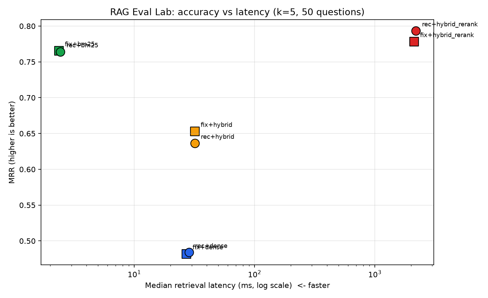

# RAG Eval Lab


**Which chunking strategy and retriever is best for your documents? Measure it instead of guessing.**

A small framework that compares 2 chunkers x 4 retrievers x 3 values of k on a RAG corpus and reports Hit@k, MRR, Precision@k and latency.



## Results (k=5, 50 questions, 12 arXiv RAG papers)

| Chunker | Retriever | Hit@5 | MRR | p50 latency |
|---|---|---|---|---|
| recursive | bm25 | 0.880 | 0.764 | 2.4 ms |
| recursive | hybrid + rerank | 0.920 | 0.793 | 2198 ms |
| recursive | hybrid | 0.860 | 0.636 | 32 ms |
| recursive | dense | 0.640 | 0.484 | 29 ms |
| fixed | bm25 | 0.900 | 0.766 | 2.4 ms |
| fixed | hybrid + rerank | 0.920 | 0.778 | 2119 ms |
| fixed | hybrid | 0.880 | 0.653 | 32 ms |
| fixed | dense | 0.640 | 0.482 | 27 ms |

Best Hit@10 overall: fixed + hybrid + rerank (0.960). Full grid in `data/results.json`.

## Findings

1. **BM25 beat dense retrieval by a wide margin** (MRR about 0.76 vs 0.48) and was about 12x faster (2.4 ms vs 28 ms).
2. **The cross-encoder reranker was the most accurate setup, but barely better than BM25** (MRR 0.78-0.79 vs 0.76) at roughly 900x the latency (about 2.2 s per query on CPU). The gain is within noise at this sample size.
3. **Hybrid (RRF) sat between dense and BM25**: it improved on dense but did not beat BM25 alone.
4. **Fixed vs recursive chunking made little difference** (MRR within 0.02).

## Limitations

- Only 50 questions, so differences under about 0.05 are noise.
- Questions were LLM-generated from the corpus (deduplicated: one question per passage, reference lists and tables of contents excluded) and spot-checked by hand.
- Questions and relevance labels both rely on lexical overlap with the source passage, which likely favors BM25.
- One domain (RAG papers), one embedding model (bge-small), CPU timings.
- An earlier version of this benchmark had duplicated passages. They were removed and every number above was recomputed.

## Run it

```bash
git clone https://github.com/makshitha0207/rag-eval-lab.git
cd rag-eval-lab/backend
pip install -r requirements.txt
# put PDFs in data/raw, add a key to backend/.env (see below)
python make_dataset.py        # generate eval questions
python run_retrieval_eval.py  # run the grid
python make_chart.py          # build the chart
```

`backend/.env` (any OpenAI-compatible API):

```
LLM_PROVIDER=openai
OPENAI_API_KEY=your-key
LLM_BASE_URL=https://api.groq.com/openai/v1
LLM_MODEL=openai/gpt-oss-20b
```

## Stack

Python, ChromaDB, sentence-transformers (bge-small), rank-bm25, cross-encoder reranker, tiktoken, pytest, GitHub Actions.

## Roadmap

LLM-as-judge for faithfulness, FastAPI service, Next.js dashboard, Qdrant backend, a human-labeled relevance set to remove the lexical bias.